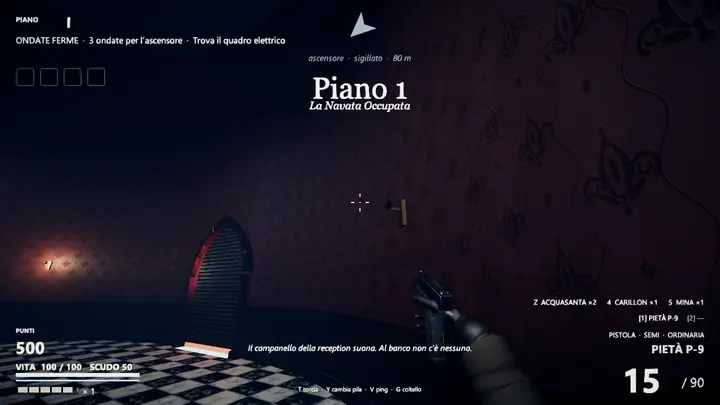

# Broken lamps

Every electric lamp that is a visible fixture of a standard floor can be broken with one shot. During a fight the lamps go out one after
another, and the room really gets darker.

## What it is

- **Kinds.** Six names are on the list: `Abatjour` (table lamp), `Lampadina` (hanging bulb), `Applique` (electric wall lamp), `arr_lampada`
  (floor lamp, see [the floor lamp](../props/arr-lampada.md)), `Neon` (neon tube) and `AstaScialitica` (surgical lamp).
- **Not breakable.** The candle wall lamps are not electric and do not break.
- **Target.** A small sphere collider on each lamp is the bullet target.

## How it works

- After the floor is built, the code finds the pool lights flagged as electric whose parent has one of those names.
- Breaking a lamp takes its light out of the pool, stops its flicker (`LampFlicker`, `NeonFlicker`), swaps its bulb, shade and tube to unlit
  materials, plays a procedural pop with glass shards (`SoundGen.BulbPop`) and throws sparks.
- In co-op a guest sends `LampHit`, the host breaks the lamp and sends `LampBroken` to everyone, and late joiners receive the broken ones
  without effects (protocol `pe-coop-25`).

## Open question: the floor lamp's shade

The breakable-lamps note says that a shot floor lamp's shade and bulb swap to their unlit materials (`paralume_spento`, `lampadina_spenta`).
The phase-5 note of 17 November 2026 found the opposite is probable: the swap happens only when a material's name contains "paralume",
"lampadina" or "neon", and the floor lamp's materials are named `A_paralume` and `A_lampadina`, which map to the existing shade and bulb
assets. So the shade probably is not swapped, and a shot floor lamp probably keeps glowing. Both notes were read in the code, and neither
was tried in the game.

## Verification

`PryingEyes.exe -batchmode -autotest -nofire -noenemies -lamptest [-lampshots] -seed 1000 -floor 1` runs ten checks on the lamps: they exist,
none is a candle, a lit one is hit by a real bullet, its light leaves the pool, the target disappears, the materials turn unlit and a second
shot does nothing. The church floor of seed 1000 has five electric wall lamps; the hotel floors have more.

## Standard and desert

The lamps break on the standard floors, once they are built. No desert script calls the breaking code, so the desert pages do not document
shot lamps. The desert's lamps come from the same room kits, and whether they break there is not known.

## Related

- [Falling chandeliers](chandeliers.md): the other electric light that a shot can bring down.
- [The floor lamp](../props/arr-lampada.md): the prop that a shot can break, with its shade and bulb.
- [Holy-oil barrels](holy-oil-barrels.md): the other shootable hazard of the same rooms.
