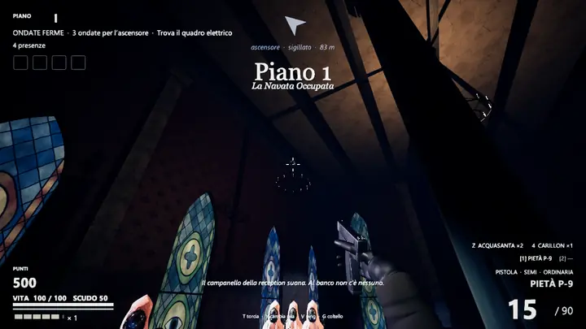

# Falling chandeliers

A chandelier is an iron crown on a chain, hung high over a church nave, a gallery hall or a hall with a fountain. Shoot it enough and it falls
on whoever stands beneath.

## What it is

- **Which ones.** Every hanging `chi_lampadario` prop of a floor whose bottom is at least 2.1 m above the floor below it. The model inside the
  prop has the same name, so only the outermost object counts. Seed 1000, floor 1, has 19 of them.
- **Target.** A sphere collider on the default layer makes it a target for bullets (`IShootable`, as the holy-oil barrels are).

## Numbers

- **Health.** 60 points of damage bring one down: two pistol shots.
- **Radius.** Enemies within 1.5 m, plus 60 % of the chandelier's half width (and 2.5 m of height), die and fly away from the impact point.
- **Bosses.** A boss under it loses a quarter of its health.
- **Players.** Players within three quarters of that radius lose 60 points of health.

## How it falls

- Its lights go out: the child lights and the lamp at its centre leave the light pool.
- The chain snaps. A third of the chain stays hanging from the ceiling; chandeliers without a chain get one at build time.
- It falls under gravity, turning 9 to 18 degrees around an axis fixed at build time, bounces a few centimetres and stays on the floor.
- Its sounds are procedural: the chain snap, a heavy thump, ringing iron, a thinning rain of crystals and rolling debris. Dust, sparks and a
  shake of the view go with it.

## Where it stands afterwards

- The fallen chandelier is an obstacle: a carving `NavMeshObstacle`, so enemies walk round it, and players can use it as cover.
- It cannot be hit again.
- Kills pay as explosions, to the player who brought it down. Three kills or more show a toast.
- In co-op a guest's hit goes to the host (`ChandelierHit`), which drops the chandelier and tells everyone (`ChandelierDrop`); protocol
  `pe-coop-24`.

## Standard and desert

The chandeliers are a standard-floor trap for the wave cycle: the code lives in `Chandeliers.cs` and the standard floor code. No desert script
refers to them, so the desert has none of them.

## Related

- [Broken lamps](broken-lamps.md): the electric lights a shot can break, in the same rooms.
- [The floor lamp](../props/arr-lampada.md): one of the electric lights that a shot can break.
- [Holy-oil barrels](holy-oil-barrels.md): the other hazard that a shot sets off.
- [The monk](../enemies/monk.md): the enemy that the fall kills most often.
