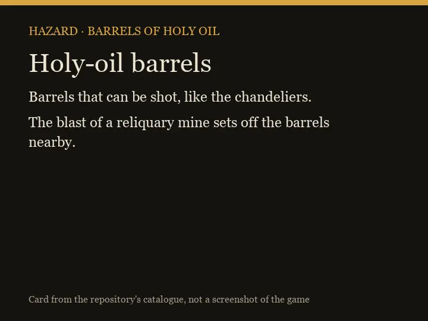

# Holy-oil barrels

Holy-oil barrels are wooden casks with iron bands and a red cross. They stand in the large rooms of the standard floors, and a shot or a
nearby blast sets them off.

## What it is

- **Model.** A wooden cask with iron bands and a red cross, a capsule collider, and a carving `NavMeshObstacle`, so enemies walk round it.
- **Targeting.** Bullets reach it through the `IShootable` interface, so it takes the hit instead of a bullet hole, as the chandeliers do.

## Numbers

- **Placement.** Three to five per floor, only in rooms at least 10 x 10 m, at least 3.5 m from any paid door, 9 m apart, on points with 1 m of
  free space. Half the time a second barrel stands right next to the first.
- **Trigger.** Two shots (40 damage), or a nearby explosion.
- **Fireball.** 520 damage at the centre and 120 at 5.5 m, with line of sight.
- **Chain.** Every other barrel within 4.5 m goes off after a short delay proportional to the distance. Barrels do not shield each other.

## Where it stands

- Holy-water flasks, carillons and the bursts of the Appestato set barrels off too.
- Kills caused by the explosion pay as explosions.
- The blast of a reliquary mine sets off the barrels near it (see [the reliquary mine](../traps/reliquary-mine.md)).
- In co-op a guest's hit sends `BarrelHit` to the host, which explodes the barrel and deals the damage (protocol `pe-coop-22`).

## Standard and desert

The barrels are a hazard of the standard floors in the wave cycle (the note calls that the survival cycle). No desert script places them.

## Related

- [Falling chandeliers](chandeliers.md): the other hazard that a shot brings down.
- [Holy water](../throwables/holy-water.md): one of the flasks that sets barrels off.
- [Carillon](../throwables/carillon.md): a throwable that sets them off too.
- [The Appestato](../enemies/appestato.md): an enemy whose burst sets them off.
