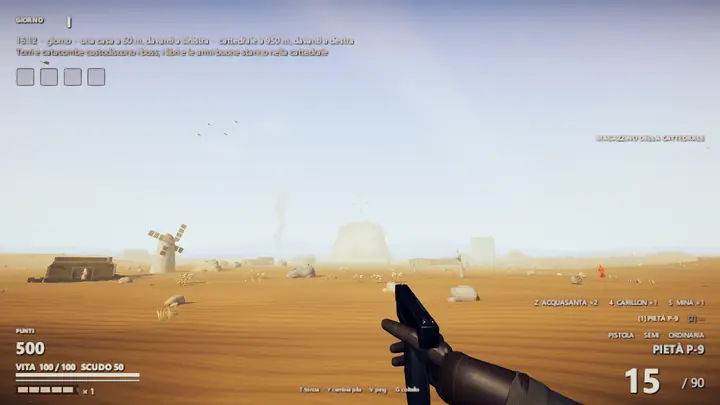

# The butte

The butte is a lone rock that stands on the sand: layered stone, a flat top, walls that are nearly vertical and a skirt of rubble at its foot.
It is the mark on the horizon that a player walks to.

## What it is

- **Size.** An ellipse 60 to 130 m long, 28 to 95 m tall, with a skirt of rubble about a fifth of its height, out to 1.55 radii.
- **Where.** At most one in each square of 900 m, placed in the middle 40% of the square so that no butte crosses into the next one. The
  chance depends on the region: four squares in five in the badlands, 30% on the salt flats, 26% in the dunes, 22% in the holy land, 18% in the
  dead town and 6% in the hamlets.
- **Never close.** A butte stays 250 m from the cathedral, 120 m from the welcome chapel and the landmark tower, and no place is made within 45 m of one.
- **Walls.** The walls are painted in strata. Steep ground, about 37 degrees and more, is rock rather than sand, so the sand cannot lie on it.

## Standard and desert

The standard game has no buttes. The desert's buttes are on the sand.

## Related

- [The badlands](../regions/badlands.md): where buttes are most common.
- [The salt flats](../regions/salt-flats.md) and [the dunes](../regions/dunes.md): regions where buttes also stand.
- [The landmark tower](landmark-tower.md): the other mark on the horizon.
- [The desert](../modes/desert.md): the open world as a whole.
