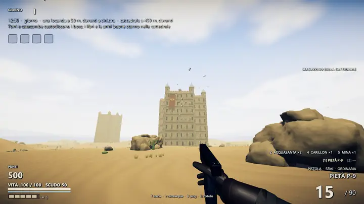

# The landmark tower

The landmark tower is a fixed mark of the desert. It stands 350 m from the cathedral, in the cell of the map that is always a tower of at
least seven floors, so every desert has one in the same place.

## What it is

- **Where.** The cell 350 m out is always a tower. The buttes never stand within 120 m of it.
- **What it is.** A tower of the stack kind, with floors and a boss in the hall of its top floor. When intact it has banners on its roof and
  walls. See [the tower](../stacks/tower.md).
- **What it is for.** It can be seen from far away and is a mark to walk to. The way-home arrow points at the cathedral, not at this tower.

## Standard and desert

The standard game has no outside towers; its Tower is the set of floors climbed through the branches. The landmark tower exists only in the desert.

## Related

- [The tower](../stacks/tower.md): the stack this landmark is.
- [The welcome chapel](welcome-chapel.md): the other fixed landmark, 100 m out.
- [The lord of the place](../enemies/signore-del-luogo.md): the boss that waits in the top hall of a tower.
- [The desert](../modes/desert.md): the open world as a whole.
