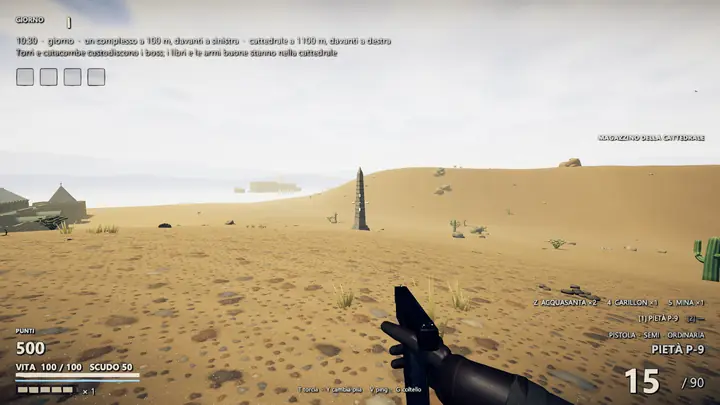

# The obelisk

The obelisk is a tall pillar of stone, 8 to 14 m high, that rises from the sand. It is one of the landmarks the desert places to be seen
from far away, and the holy land is where the obelisks stand with the chapels, the churches and the steles.

## What it is

- **Height.** 8 to 14 m.
- **Where.** On the open sand of the holy land, among the steles and columns; the desert page lists obelisks among the things on the sand.
- **Use.** It is a mark on the horizon. The desert page gives it no other rule.

## Standard and desert

The standard game has no obelisks. Its holy places are the nave of the cathedral and the chapels of the floors. The desert's obelisks are outside.

## Related

- [The holy land](../regions/holy-land.md): where the obelisks stand.
- [The church](../places/church.md): a place whose yard holds steles and a column, like the obelisks' ground.
- [The landmark tower](landmark-tower.md): the other fixed mark of the desert.
- [The desert](../modes/desert.md): the open world as a whole.
