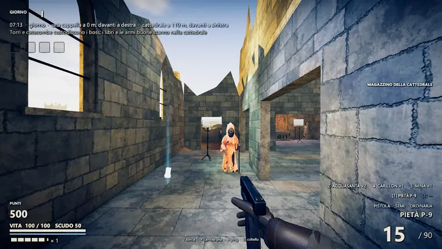

# The welcome chapel

The welcome chapel is the first place of the desert that a player meets. It stands about 100 m from the cathedral, in the cell of the
map that is always a ruined chapel, so every new desert has one in the same place.

## What it is

- **Where.** The cell 100 m out from the cathedral is always a ruined chapel. The buttes never stand within 120 m of it.
- **What it is.** A chapel of the desert's places, built from the rooms of the floors and left in ruin, with the guards of every place.
- **Its rule.** The desert page gives the welcome chapel no rule of its own; it is a fixed point on the sand.

## Standard and desert

The desert has landmarks and the standard game has none; its chapels are inside the cathedral and the floors. The welcome chapel is
only in the desert.

## Related

- [The chapel](../places/chapel.md): the kind of place it is.
- [The landmark tower](landmark-tower.md): the other fixed landmark, at 350 m.
- [The cathedral](../zones/cathedral.md): the base that the welcome chapel is measured from.
- [The desert](../modes/desert.md): the open world as a whole.
