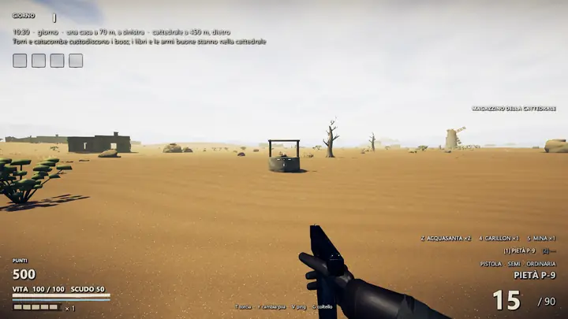

# The well

The well is one of the landmarks of the desert that can be seen from afar. It is a round hole in the sand with a stone curb, and it is the
way down to a catacomb: the desert's mausoleums have a stair that goes down through a well in the sand.

## What it is

- **Landmark.** A well shows on the horizon. Wells are among the things of the hamlets.
- **Hole.** The sand round a well is cut so that the hole is clean.
- **Catacomb.** When a well is the entrance of a catacomb, its stair goes down to three to five levels. The minimap draws a catacomb as an arc.

## Standard and desert

The standard game has no wells: its way down is the lift and the five gates behind the apse. The desert's wells are landmarks on the sand.

## Related

- [The catacomb](../stacks/catacomb.md): the stack a well can lead down to.
- [The hamlets](../regions/hamlets.md): the region where wells are among the things of the land.
- [The windmill](windmill.md): another landmark of the hamlets.
- [The desert](../modes/desert.md): the open world as a whole.
