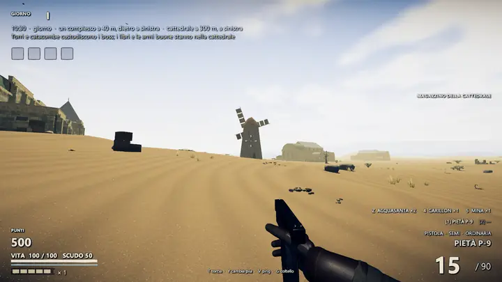

# The windmill

The windmill is a ruined mill of the hamlets. Its sails turn with the wind, so it moves when the desert is windy.

## What it is

- **Sails.** The sails turn with the wind, which the desert simulates for the whole sky (gusts, strength and direction).
- **Where.** In the hamlets, among the houses and wells: the hamlets' list of things includes windmills.
- **Sound.** The desert page says that the wind turns the windmills and is heard across the sand.

## Standard and desert

The standard game has no windmills.

## Related

- [The hamlets](../regions/hamlets.md): where the windmills stand.
- [The well](well.md): the other landmark of the hamlets.
- [The house](../places/house.md): the most common place of the hamlets, among which the windmills stand.
- [The desert](../modes/desert.md): the open world as a whole.
