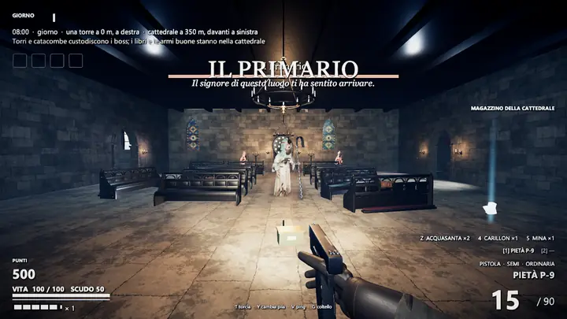

# The boss level

The third level of a branch holds its boss. It is the level you come to with the satchel full, and the one where the branch's trophy is
earned.

## How the boss arrives

1. Three waves are cleared; the gate of the level is still shut.
2. The next wave opens with the boss and half of the usual escort. The boss has at least the hit points of the eighth-wave Cardinale,
   plus 25% for each branch, and its name is on the top bar.
3. The gate opens only when that wave is cleared. At that moment the boss's trophy goes to the store: three of its resource the first
   time, two after, plus 12 to 18 common and 3 rare resources. It is kept even if you die before reaching the stair.
4. The gate of this level leads up, back to the cathedral. In the [Abyss](../zones/abyss.md) the gate goes on down instead.

The boss stands in the level's [boss room](../rooms/boss-room.md). The bosses are the [Cardinale](../enemies/cardinale.md) of the
first branch, the [Direttore](../enemies/direttore.md) of the second, the [Primario](../enemies/primario.md) of the third and the
[Conte](../enemies/conte.md) of the fourth.

## Standard and desert

Only the standard game has boss levels. The desert has bosses too, in the top hall of its towers and catacombs, but those are
[stacks](../stacks/tower.md) with no gate and no trophy in the same sense; see [the desert](../modes/desert.md) and the
[the lord of the place](../enemies/signore-del-luogo.md).

## Related

- [The first level](first-level.md): where the descent into the branch starts.
- [The wave cycle](../cycles/wave-cycle.md): the waves that come before the boss.
- [Il Rosone](../works/il-rosone.md): the last work, which opens the Abyss after the four bosses.
