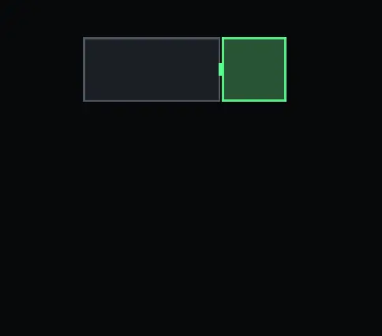

# The first level of a branch

Every branch of the catacombs has three levels, and the first one is where you arrive. It is a floor of the old Tower, with the theme of
its branch, and it plays the same way: waves, areas bought with points, perks, the mystery chest and the altar.

## What you find when you arrive

- **The gate.** The arrival is a stone landing closed by an iron [portcullis](../gates/portcullis.md) that rises, with the steps you came
  down on one side.
- **The poor box.** Next to the arrival, the *cassetta delle elemosine* turns 500 points into 33 oboli at once, and is safe even if you
  die afterwards.
- **Your remains.** If you died on an earlier descent into this branch, the resources you left are here, marked by a column of light.
  Reach them on the next descent and they go back into the satchel.
- **The banner.** It names the branch and the level (for example *L'Ossario · livello II*); the guide arrow says *cancello*, and the
  HUD says *LIVELLO*.

## Standard and desert

Only the standard game has levels. In the desert the same idea is a [stack](../stacks/catacomb.md): a tower of levels with its
boss on the top floor and no gates and no satchel. See [the desert](../modes/desert.md).

## Related

- [The boss level](boss-level.md): the third level, where the branch's boss waits.
- [The catacombs](../zones/catacombs.md): the branches the levels belong to.
- [The wave cycle](../cycles/wave-cycle.md): how the waves of a level run.
