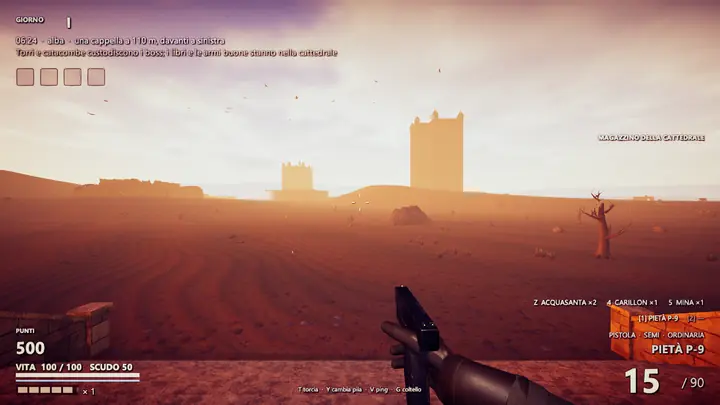

# The desert

The desert is the second way to play: an open world of sand built from one seed. You leave the [cathedral](../zones/cathedral.md) by its stair and walk, or ride a [motorbike](../vehicles/moto.md), across regions with their own ground, buildings and enemies. Its towers and catacombs are [stacks](../stacks/tower.md) built on the sand. Its time is a day of twenty minutes with a [night](../cycles/day-night.md), and its weather is the [sandstorm](../cycles/sandstorm.md).

## Regions and places

The seed lays out six regions: the [badlands](../regions/badlands.md) of red ground and mesas, the [dead town](../regions/dead-town.md) of ash-grey hotels, theatres and sanatoria falling apart, the [dunes](../regions/dunes.md), the [hamlets](../regions/hamlets.md) of small houses, inns, wells and windmills, the [holy land](../regions/holy-land.md) of chapels, churches and obelisks, and the [salt flats](../regions/salt-flats.md). Places stand in them: [houses](../places/house.md), [inns](../places/inn.md), [chapels](../places/chapel.md), [churches](../places/church.md), [hotels](../places/hotel.md), [theatres](../places/theatre.md), [sanatoria](../places/sanatorium.md) and [complexes](../places/complex.md).

## Landmarks, camps and finds

[Landmarks](../landmarks/landmark-tower.md) show from afar and help you find your way: the [welcome chapel](../landmarks/welcome-chapel.md), the [obelisk](../landmarks/obelisk.md), the [well](../landmarks/well.md), the [windmill](../landmarks/windmill.md) and the [butte](../landmarks/butte.md). The [campfires](../camps/campfire.md) burn only at night. The sand gives gold coins (see [points](../pickups/points.md)), a [medikit](../pickups/medikit.md), [essence](../pickups/essence.md) and an [ammunition crate](../pickups/ammunition-crate.md).

## Enemies and animals

The desert draws its walkers from eight kinds, among them the [monk](../enemies/monk.md), the [flagellante](../enemies/flagellante.md), the [appestato](../enemies/appestato.md) and the [statua](../enemies/statua.md), and in its sanatoria, and in the towers given the sanatorium theme, the [infermiere](../enemies/infermiere.md); in its theatres, the [maschera](../enemies/maschera.md). Each tower and catacomb ends in a hall with one of four bosses, the [lord of the place](../enemies/signore-del-luogo.md). By day the [lizards](../creatures/lizard.md), [scarabs](../creatures/scarab.md) and [scorpions](../creatures/scorpion.md) live on the sand and run away; [vultures](../creatures/vulture.md) circle the ruins.

## Day, night and weather

A day lasts twenty minutes: about twelve of daylight and eight of night. The enemies rest by day and wake when you come within 30 m, or within 48 m at night (see [day and night](../cycles/day-night.md)). About one day in two a [sandstorm](../cycles/sandstorm.md) blows between 08:00 and 22:00 and thickens the fog.

## Getting around

The [minimap](../systems/minimap-and-way-home.md) shows a 512 m chart drawn north up, and from 90 m away the arrow points you home. Each player has a [motorbike](../vehicles/moto.md) at the foot of the cathedral stair: you get on and off with `F`, the speedometer is in km/h, you can shoot from the saddle, and the wheels leave tracks in the sand.

## The cathedral in the desert

The cathedral keeps its store, its works and its market. Its [Library of Vows](../works/biblioteca-dei-voti.md) sells perk books, and the [Altar of Consecration](../works/altare-della-consacrazione.md) consecrates the weapon in your hand. The [armoury](../zones/cathedral.md) sells weapons at twice the standard price. The sand gives only grade I weapons for free, and grade II in a boss hall.

## Co-op and split screen

Up to four players share one desert. Each machine builds the same world from the host's seed, and each seat of a [split screen](../systems/split-screen.md) starts its own expedition. Nothing of the desert is saved; see [characters and saves](../systems/saves-and-characters.md).

## Standard and desert

- **Desert.** This mode: no waves, no candles, no stealth, no catacomb expedition to bring home, and a clock and weather of its own.
- **Standard.** Without the desert, the standard game has the waves, the trials, the [satchel](../systems/satchel.md), the oboli, the blessings, the annexes and the power panel. The [standard mode](standard.md) has them; the desert has the open sand instead. The full list is in [standard vs desert](../standard-vs-desert.md).

## Related

- [Standard mode](standard.md): the other mode.
- [Standard vs desert](../standard-vs-desert.md): every page that differs between the two.
- [Day and night](../cycles/day-night.md): the clock of the sand.
