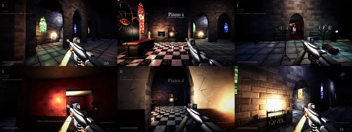

# Standard mode

Standard mode is the game the project was built around. You start in a cathedral that you rebuild with the points and the resources you bring back from the catacombs. Under it, the catacombs are floors in four branches, each with its own boss behind a gate. The enemies come at you in waves (the default) or, in the legacy candle cycle, you sneak past them.

## The cathedral

The [cathedral](../zones/cathedral.md) is the base: the square and its market outside, the works inside, and the five gates behind the apse that lead down. The works cost steel, wood, bones or the rare resources. The [forge](../works/la-forgia.md) adds 15% damage with every weapon, and the [organ](../works/lorgano.md) heals you fully after every wave you clear. The market trades with you: the [apothecary](../stalls/speziale.md) sells holy water and candles, the [bone cart](../stalls/carro-ossaio.md) sells lots of bones, and the [surgeon's tent](../stalls/tenda-cerusico.md) sells one rare resource at a time.

## The catacombs

The [catacombs](../zones/catacombs.md) are the way down. Each branch is three levels: the [first level](../levels/first-level.md), the middle floors, and the [boss level](../levels/boss-level.md), where the branch's boss waits behind its gate. The branches are:

- [L'Ossario](../branches/ossario.md), the first, open from the start, with the Cardinale as its boss;
- [Il Teatro sepolto](../branches/teatro-sepolto.md), the second, with the [Direttore](../enemies/direttore.md);
- [Il Sanatorio](../branches/sanatorio.md), the third, with the [Primario](../enemies/primario.md);
- [Il Guardaroba del Conte](../branches/guardaroba.md), the fourth, with the [Conte](../enemies/conte.md).

Beyond them is the [Abyss](../zones/abyss.md), the fifth gate, opened by the Rosone. The gates close the stone landings: a [portcullis](../gates/portcullis.md) rises when the way is open, and the [shutters](../gates/shutter.md) close the lifts of the wave floors until three waves are cleared.

The floors are full of [monks](../enemies/monk.md), [flagellanti](../enemies/flagellante.md), [statues](../enemies/statua.md), [appestati](../enemies/appestato.md) and [veglie](../enemies/veglia.md). The [medusa](../enemies/medusa.md) flies over the lower floors. The [stealth](../systems/stealth.md) rules decide how they notice you, but only in the candle cycle.

## Waves, trials and the procession

The [wave cycle](../cycles/wave-cycle.md) starts each wave on its own: 16 enemies plus 4 per wave, a [procession of lights](../enemies/veglia.md) every fifth wave and a [Cardinale](../enemies/cardinale.md) every eighth. From the second wave, every even wave that is not a procession offers a [trial](../trials/testa.md): [Testa](../trials/testa.md), [Coltello](../trials/coltello.md), [Esplosivi](../trials/esplosivi.md), [Intatto](../trials/intatto.md) or [Furia](../trials/furia.md).

## Points, perks and magic

Points buy doors, perks, weapons and power-ups (see [points and oboli](../systems/points-and-oboli.md)). The points you bring back from a catacomb expedition become oboli, one for every ten points. The [perks](../systems/perks.md) are eight magic books in the libraries. The two grimoires, [The Book of Witchcraft](../grimoires/witchcraft.md) and [The Book of the Arsenal](../grimoires/arsenal.md), hold the spells and the seals. The [altar](../systems/blessings.md) offers a blessing before each descent.

## Standard and desert

- **Standard.** This mode: the cathedral, the catacombs, the waves and the trials. Its candle cycle is still there behind the `-candles` flag.
- **Desert.** The other mode is one open world of sand, with no waves, no catacombs and no stealth. Its towers and catacombs are [stacks](../stacks/tower.md) built on the sand. See [the desert](desert.md) and [standard vs desert](../standard-vs-desert.md).

## Related

- [The desert](desert.md): the other mode.
- [Standard vs desert](../standard-vs-desert.md): every page that differs between the two.
- [The catalogue](../catalog.md): every page of the wiki.
