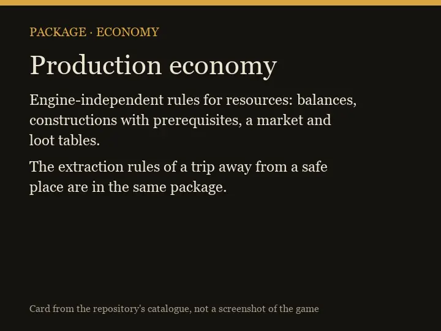

# Production Economy

`com.pryingeyes.economy` (version 0.1.0, displayed as Production Economy) is the rule set of the money. It names no engine and no game: it is a ledger of resources, one-off constructions, market exchanges, weighted loot and extraction rules. Its `.cs` files compile in the [economy lab](../pipeline/labs.md) without the editor.

## What it holds

- **The ledger.** What the store holds, what each purchase spends and what each return brings back.
- **One-off constructions.** A work of the cathedral is built once and then stays built.
- **Market exchanges.** A lot is bought and sold back at the prices of its stall, such as the [bone cart](../stalls/carro-ossaio.md).
- **Weighted loot.** Drops are chosen by weight, so some are rare.
- **Extraction.** What you keep when you come back from the catacombs, and what a death takes; see [the satchel](../systems/satchel.md).

The cathedral's store and its markets are the same in both modes, so the rules serve both (see [the desert](../modes/desert.md)).

## Checks

`python tools/studio.py test economy` runs in the [CI gate](../pipeline/ci-gate.md) and checks the package and the cathedral catalogue.

## Related

- [Points and oboli](../systems/points-and-oboli.md): the currency the ledger counts.
- [Labs](../pipeline/labs.md): the engine-free test that compiles this package.
- [Suite architecture](../../docs/engineering/suite-architecture.md): why the packages carry no game names.
