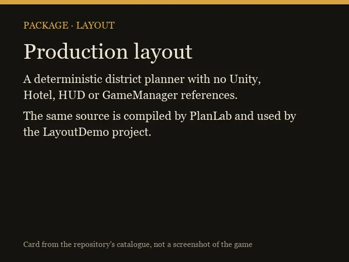

# Production Layout

`com.pryingeyes.layout` (version 0.1.0, displayed as Production Layout) turns a seed into a district layout. The same seed always gives the same plan, and the package has no Unity code and no game names. Its code is compiled by `tools/planlab`, an engine-free lab, from the same source file that Unity uses.

## Why it is separate

The package is the first proof that the production suite can be reused. The independent project `unity/LayoutDemo` consumes it through a `file:` reference and draws a layout with it, so a change that breaks the package breaks that project too. The rules that keep it reusable are in [suite architecture](../../docs/engineering/suite-architecture.md).

## Where it is used

Its first consumer is the independent project `unity/LayoutDemo`. The district of the [city prototype](../projects/city-prototype.md) is built from a recipe of its own, `citta.json`; see that page.

## Related

- [Labs](../pipeline/labs.md): the engine-free tests that compile the packages.
- [Check suite](../pipeline/check-suite.md): the guard that keeps the package free of game names.
- [City prototype](../projects/city-prototype.md): the district this kind of layout serves.
