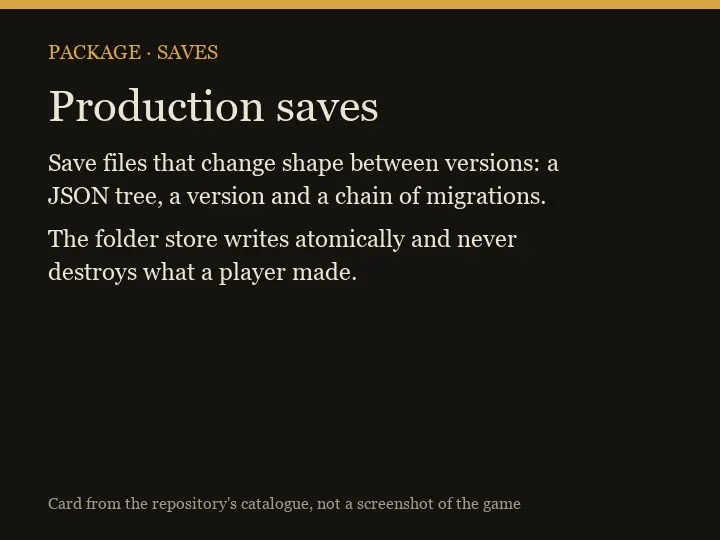

# Production Saves

`com.pryingeyes.saves` (version 0.1.0, displayed as Production Saves) keeps the player's characters and their suspended expeditions. It has three parts: a JSON tree, the versioned formats with their chain of migrations, and a file store that never leaves a half-written file behind.

## What it guarantees

- A save written by an older version is upgraded one step at a time, and a copy of the old file is kept in `backup/` before the upgrade.
- A save from a newer version is never opened and never overwritten.
- A file that cannot be understood is moved to `quarantine/`, never deleted.
- A write goes to a temporary file that then replaces the old one, so a failed write leaves the old file as it was.

The full recipe, the files and the version history are in [the save system](../../docs/engineering/save-system.md). What the player keeps is in [characters and saves](../systems/saves-and-characters.md).

## Checks

`python tools/studio.py test saves` runs in the [CI gate](../pipeline/ci-gate.md): the library and the character and run files, 115 checks.

## Related

- [Characters and saves](../systems/saves-and-characters.md): what a save holds, as the player sees it.
- [Save system](../../docs/engineering/save-system.md): the rules for changing a save without breaking the old ones.
- [Labs](../pipeline/labs.md): the engine-free test of this package.
