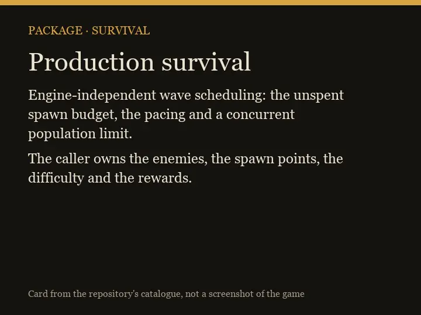

# Production Survival

`com.pryingeyes.survival` (version 0.1.0, displayed as Production Survival) holds the rules that a wave needs and that do not depend on the engine: how many enemies a wave is worth, how fast they come, and how many may be alive at once. The [wave cycle](../cycles/wave-cycle.md) follows rules of this kind: 16 enemies plus 4 per wave, at most 12 plus 1 per wave alive at a time, and spawns spread over the open areas.

## Checks

`python tools/studio.py test survival` runs in the [CI gate](../pipeline/ci-gate.md) and compiles the package through the survival lab, `tools/survivallab`, without the editor.

## Related

- [The wave cycle](../cycles/wave-cycle.md): the waves these rules describe.
- [Labs](../pipeline/labs.md): the engine-free tests of the packages.
- [Trial: Testa](../trials/testa.md): one of the challenges that come with a wave.
