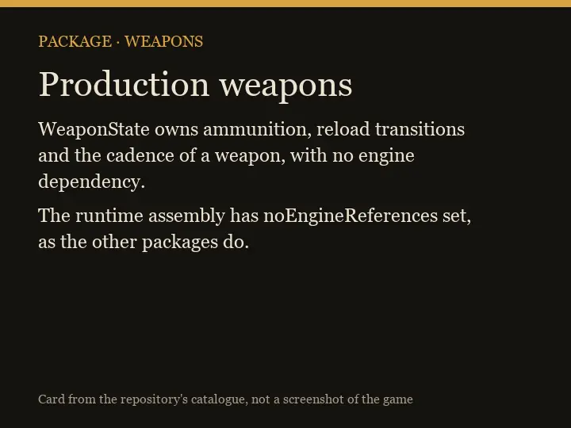

# Production Weapons

`com.pryingeyes.weapons` (version 0.1.0, displayed as Production Weapons) holds the numbers of a weapon and nothing else. It has the record of a weapon as the catalogue writes it (damage and its fall with range, rate of fire, magazine, recoil, accuracy, and the hints for sight and sound that the game reads) with the rules that a catalogue must satisfy, the arithmetic of the gunplay (the fraction of the damage left at a distance, the cone a shot falls in, the bloom that each shot leaves and the kick of the view), and the mechanical state of a weapon: how many rounds are in the magazine and in the reserve, which step a reload is in, and how fast the shots follow each other. The game reads `weapons.json` itself, draws the random numbers, finds the direction of each bullet and keeps everything that looks, sounds or moves. Its `Weapon` class still mixes its input and its presentation with the state, which was extracted so that the state can be checked without the editor.

## Checks

`python tools/studio.py test weapon-state` runs in the [CI gate](../pipeline/ci-gate.md). It compiles the package through `tools/weaponslab`, which compares its arithmetic with a frozen copy of the expressions that the game had, to the last bit. Each of the game's weapons has a page of its own, starting with [the Pieta P-9](../weapons/pieta-p9.md).

## Related

- [Pieta P-9](../weapons/pieta-p9.md): the starting pistol, whose numbers this state follows.
- [Labs](../pipeline/labs.md): the engine-free tests of the packages.
- [Suite architecture](../../docs/engineering/suite-architecture.md): the note on what the game still mixes into `Weapon.cs`.
