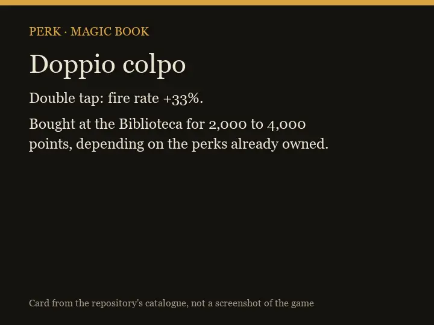

# Doppio colpo

Doppio colpo (*double tap*) is one of the eight perks. It raises the fire rate of your weapon by 33%.

## What it does

- **Fire rate.** +33%.
- **Slot.** It takes one of the four perk slots.

## Where it comes from

- **Book.** It is bought as a magic book in the library of the floor, at the price of the slot you are filling.

## Standard and desert

- **Standard.** The library of each catacomb floor offers it.
- **Desert.** The Library of Vows in the cathedral sells perk books at the same prices. The desert doc does not list which books it offers.

## Related

- [Perks](../systems/perks.md): the eight perks and the four slots.
- [Mani svelte](mani-svelte.md): the perk that speeds the reload instead.
- [Weapon grades](../grades/grade-1.md): the weapons a fire rate changes.
