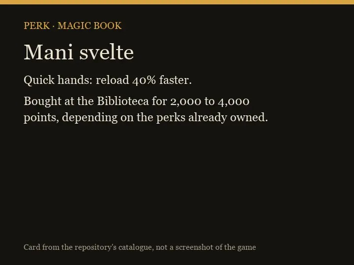

# Mani svelte

Mani svelte (*quick hands*) is one of the eight perks. It makes every reload 40% faster.

## What it does

- **Reload.** Reloading takes 40% less time.
- **Slot.** It takes one of the four perk slots.

## Where it comes from

- **Book.** It is bought as a magic book in the library of the floor, at the price of the slot you are filling.
- **Work.** The [Cappella delle Mani](../works/la-cappella-delle-mani.md) starts every expedition with it, and it takes a perk slot.

## Standard and desert

- **Standard.** The library of each catacomb floor offers it.
- **Desert.** The Library of Vows in the cathedral sells perk books at the same prices. The desert doc does not list which books it offers.

## Related

- [Perks](../systems/perks.md): the eight perks and the four slots.
- [The Cappella delle Mani](../works/la-cappella-delle-mani.md): the work that gives it at the start.
- [Pelle di pietra](pelle-di-pietra.md): the other perk a work can give.
