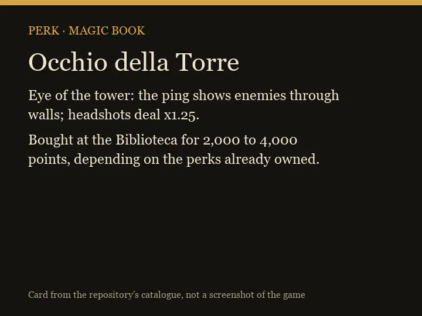

# Occhio della Torre

Occhio della Torre (*the eye of the tower*) is one of the eight perks. It lets you see the enemies through the walls for a moment, and it
makes headshots hit harder.

## What it does

- **Ping.** The ping shows the enemies through the walls.
- **Headshots.** Headshots do 25% more damage (×1.25).
- **Slot.** It takes one of the four perk slots.

## Where it comes from

- **Book.** It is bought as a magic book in the library of the floor, at the price of the slot you are filling.

## Standard and desert

- **Standard.** The library of each catacomb floor offers it. The ping's length is in the code, and the docs did not check it.
- **Desert.** The Library of Vows in the cathedral sells perk books at the same prices. The desert doc does not list which books it offers.

## Related

- [Perks](../systems/perks.md): the eight perks and the four slots.
- [Stealth](../systems/stealth.md): the eyes that show the enemies' awareness.
- [Medals](../systems/medals.md): the headshot and kill feats.
