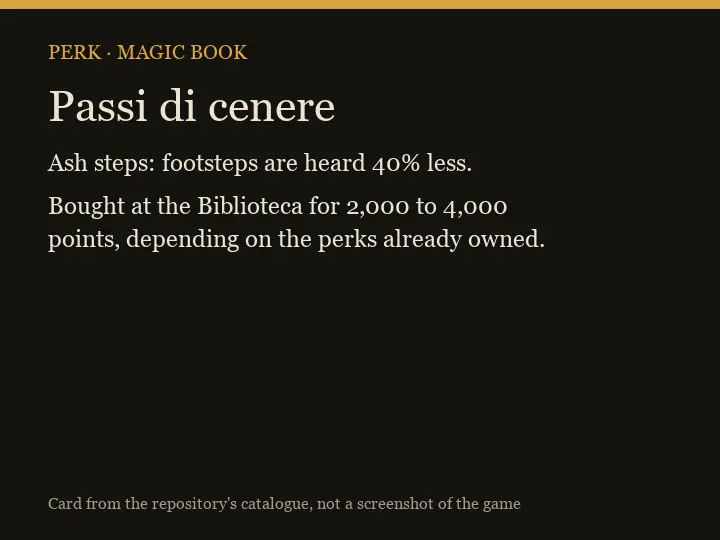

# Passi di cenere

Passi di cenere (*ash steps*) is one of the eight perks. Your footsteps are heard 40% less, which matters where enemies listen for them.

## What it does

- **Footsteps.** Heard 40% less.
- **Slot.** It takes one of the four perk slots.

## Where it comes from

- **Book.** It is bought as a magic book in the library of the floor, at the price of the slot you are filling.

## Standard and desert

- **Standard.** Enemies listen for footsteps on the catacomb floors, so the perk counts there.
- **Desert.** The desert has no stealth: its walkers wake by distance and by being hit, not by noise (the desert doc). The perk applies to
  the sound you make, but the desert doc does not say that it changes the wake-up.

## Related

- [Perks](../systems/perks.md): the eight perks and the four slots.
- [Stealth](../systems/stealth.md): the listening and seeing enemies of the standard floors.
- [The desert](../modes/desert.md): where enemies wake by distance.
