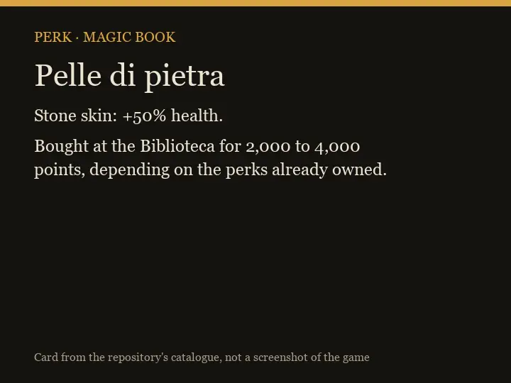

# Pelle di pietra

Pelle di pietra (*stone skin*) is one of the eight perks. It gives +50% health, and it is the perk the Cappella della Pietra can give you
at the start of every expedition.

## What it does

- **Health.** +50% maximum health.
- **Slot.** It takes one of the four perk slots, like every perk.
- **Death.** Dying takes the last perk you bought, the death penalty of the tower note. If the stone skin was the last one bought, it is the first to go.

## Where it comes from

- **Book.** It is bought as a magic book in the library of the floor, for the price of the slot you are filling
  (2,000, 2,500, 3,000 or 4,000 points).
- **Work.** The [Cappella della Pietra](../works/la-cappella-della-pietra.md) starts every expedition with it, and it takes a perk slot.

## Standard and desert

- **Standard.** The library of each catacomb floor offers it.
- **Desert.** The Library of Vows in the cathedral sells perk books at the same prices. The desert doc does not list which books it offers.

## Related

- [Perks](../systems/perks.md): the eight perks and the four slots.
- [The Cappella della Pietra](../works/la-cappella-della-pietra.md): the work that gives it at the start.
- [Death](../systems/downed-and-revive.md): what dying costs.
