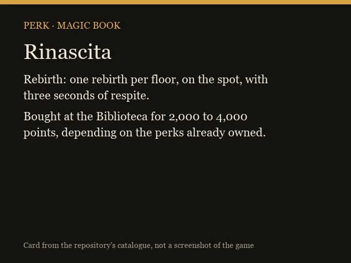

# Rinascita

Rinascita (*rebirth*) is one of the eight perks. Once per floor it lets you rise on the spot when you would die, with three seconds of
respite, instead of dying.

## What it does

- **Rebirth.** Once per floor, on the spot, with three seconds of respite.
- **Downed.** When it applies, it replaces the downed state: you do not go down, you rise.
- **Slot.** It takes one of the four perk slots.

## Where it comes from

- **Book.** It is bought as a magic book in the library of the floor, at the price of the slot you are filling.
- **Candle.** The apothecary's [Cero votivo](../stalls/speziale.md), for 120 oboli, starts an expedition with the Rinascita book.

## Standard and desert

- **Standard.** The library of each catacomb floor offers it, and the candle can start it.
- **Desert.** The Library of Vows in the cathedral sells perk books at the same prices. The desert doc does not list which books it offers.

## Related

- [Downed and revive](../systems/downed-and-revive.md): the state the perk replaces.
- [Perks](../systems/perks.md): the eight perks and the four slots.
- [The apothecary](../stalls/speziale.md): the stall that sells the candle.
