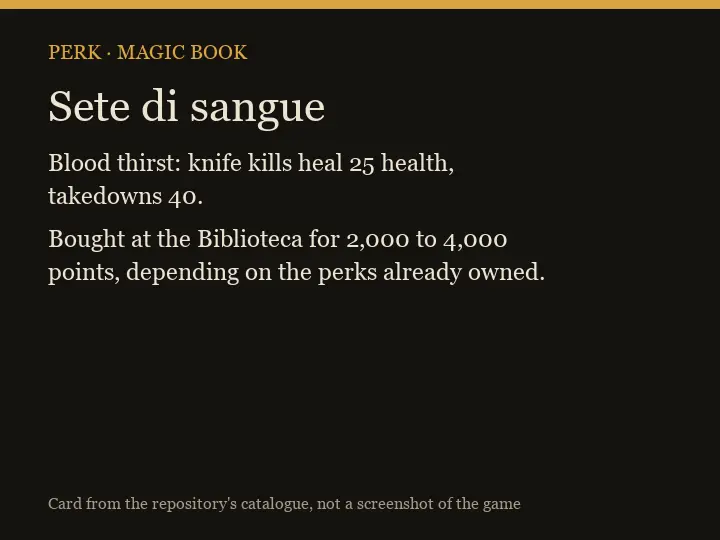

# Sete di sangue

Sete di sangue (*blood thirst*) is one of the eight perks. The knife feeds it: each knife kill heals you, and a takedown heals more.

## What it does

- **Knife kills.** Heal 25 points.
- **Takedowns.** Heal 40 points.
- **Slot.** It takes one of the four perk slots.

## Where it comes from

- **Book.** It is bought as a magic book in the library of the floor, at the price of the slot you are filling.

## Standard and desert

- **Standard.** The library of each catacomb floor offers it. The knife and its takedowns are part of the catacomb floors.
- **Desert.** The Library of Vows in the cathedral sells perk books at the same prices. The desert doc does not list which books it offers.

## Related

- [Perks](../systems/perks.md): the eight perks and the four slots.
- [Takedown and the knife](../systems/knife.md): the knife and its takedown.
- [Pelle di pietra](pelle-di-pietra.md): the health perk.
