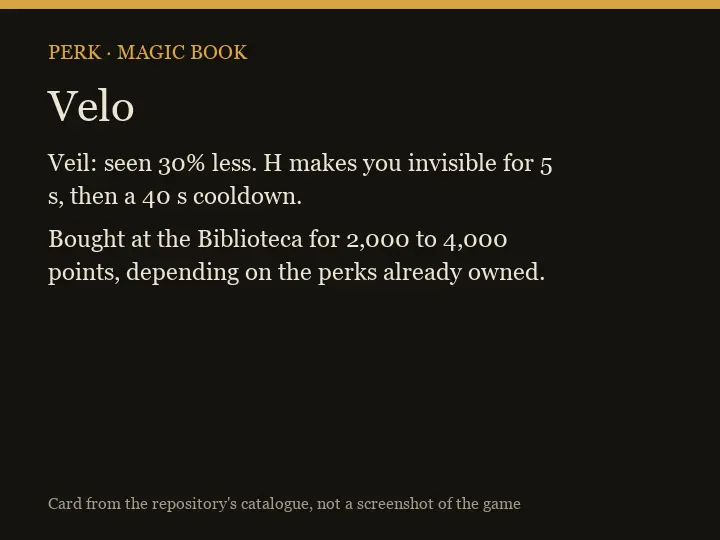

# Velo

Velo (*veil*) is one of the eight perks. You are seen 30% less, and with `H` you vanish for five seconds, then rest.

## What it does

- **Seen.** 30% less.
- **Invisible.** `H` makes you invisible for five seconds, then a rest of 40 seconds before it works again.
- **Slot.** It takes one of the four perk slots.

## Where it comes from

- **Book.** It is bought as a magic book in the library of the floor, at the price of the slot you are filling.

## Standard and desert

- **Standard.** On the candle-cycle floors the veil works. The wave cycle, which is the default, does not offer it, so `H` is in practice a
  candle-cycle thing.
- **Desert.** The desert doc does not mention the veil, and the desert has no stealth to hide from.

## Related

- [Perks](../systems/perks.md): the eight perks and the four slots.
- [The candle cycle](../cycles/candle-cycle.md): where the veil is on offer.
- [Stealth](../systems/stealth.md): what the veil hides you from.
