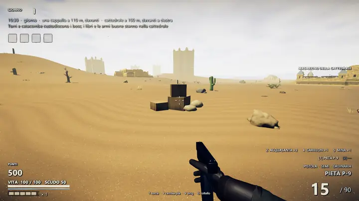

# Ammunition crate

The ammunition crate (`PickKind.Ammo`) is a small olive crate with a brass lid and an amber light on its front.

## What it is

- **Effect.** Each weapon you carry, in either of the two slots, gets half of its maximum reserve, rounded up, added to its reserve. The reserve never goes above the maximum (`Weapon.AddAmmoFraction`). The magazine is not touched.
- **Taking it.** Walk within 1.6 m (the note says 1.5 m), as with every desert find.

The desert note calls the effect "half a magazine reserve". The code measures the half against each weapon's maximum reserve, not against a magazine, and it refills both weapons, not only the one in hand.

## Numbers

- **Share.** 26 in 100 of the finds in places, and 28 in 100 of the open-sand caches (see [Points](points.md)).
- **Price.** The desert note says that buying ammunition for a weapon you own costs 150 points, the same as always.

## Standard and desert

Desert only, as a find. In the standard game the [Reliquiario](../power-ups/reliquiario.md) power-up does the same job at full strength: it fills the magazines and the reserves of both weapons to the maximum.

## Related

- [Reliquiario](../power-ups/reliquiario.md): the standard game's ammunition power-up.
- [Points](points.md), [Medikit](medikit.md) and [Essence crystal](essence.md): the other desert finds.
