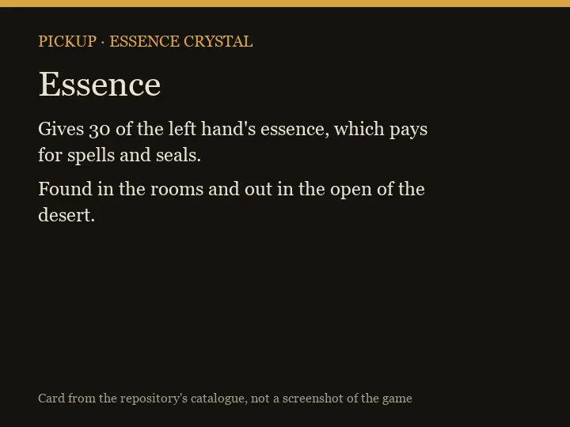

# Essence crystal

The essence crystal (`PickKind.Essence`) is a shining crystal, the resource of the left hand.

## What it is

- **Effect.** Adds 30 essence, up to the maximum. The toast reads "Essenza +30".
- **Taking it.** Walk within 1.6 m (the note says 1.5 m).

## Numbers

- **Essence.** The left hand starts with 60 essence and its maximum is 100, which a Witchcraft item can raise. It comes back at 2 a second, and each kill gives 3 (`MagicState.cs`).
- **Costs.** The spells cost 25 to 60 essence: [Sigillo di Sangue](../spells/sigillo-di-sangue.md) costs 25 and [Essenza Maledetta](../spells/essenza-maledetta.md) 60. The seals cost 40, and the top seal, [Arma Maledetta](../seals/arma-maledetta.md), costs 60.
- **Share.** 22 in 100 of the finds in places, and 22 in 100 of the open-sand caches.

## Standard and desert

Desert only, as a find. The standard game has no essence pickup: the essence comes back by itself and from kills, as the arms and magic note describes.

## Related

- [Fiamma Sacrilega](../spells/fiamma-sacrilega.md) (30 essence) and [Danni Critici](../seals/danni-critici.md) (40 essence): one spell and one seal.
- [The Book of Witchcraft](../grimoires/witchcraft.md): the grimoire that holds the spells.
- [Points](points.md): another desert find.
