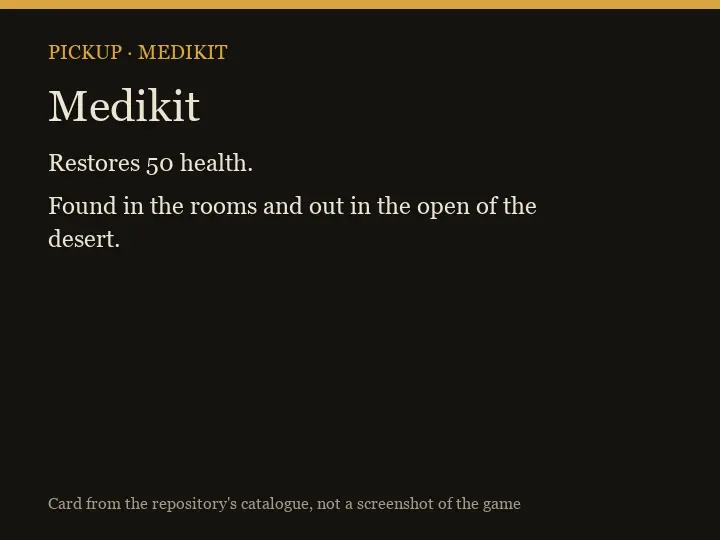

# Medikit

A medikit (`PickKind.Medikit`) is a white box with a red cross on its front.

## What it is

- **Effect.** Restores 50 health; the toast reads "Medikit: +50 vita".
- **Taking it.** Walk within 1.6 m (the note says 1.5 m).

## Numbers

- **Share.** 16 in 100 of the finds in places, and 16 in 100 of the open-sand caches (see [Points](points.md)).
- **Amount.** Places and caches both set 50.

## Standard and desert

Desert only, as a find. In the standard game health comes back from the [organ](../works/lorgano.md), which heals you fully and raises the shield to 100 after every wave you clear. The desert has no waves, so the organ has nothing to answer there.

## Related

- [The organ](../works/lorgano.md): the standard game's healing.
- [Points](points.md), [Ammunition crate](ammunition-crate.md) and [Essence crystal](essence.md): the other desert finds.
