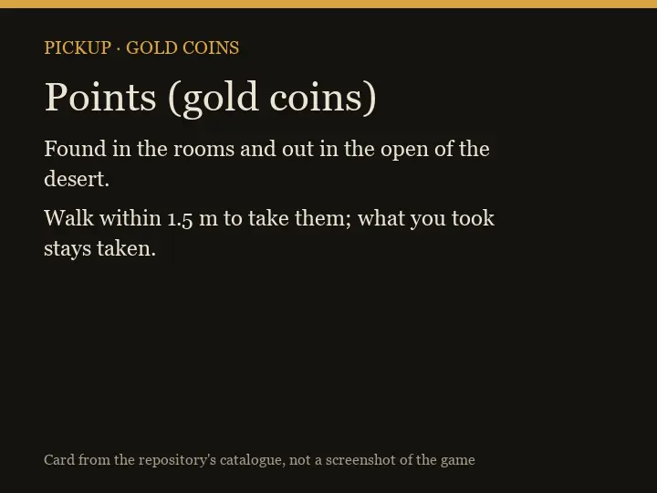

# Points (gold coins)

Gold coins (`PickKind.Points`) are the desert's points pickup: a small stack of coins that hovers and turns, with a soft column of light in its colour, so you can see it from afar.

## What it is

- **Taking it.** Walk within 1.6 m of it, measured to your chest. The desert note says 1.5 m; the code uses 1.6 m. A coin you take does not come back, even when its place is loaded again.
- **Effect.** Its value goes to the score at once, and a toast reads "+N punti".
- **Offerta.** While the [Offerta](../power-ups/offerta.md) power-up runs, the value is doubled, as every gain of points is.
- **Sound.** The coin sound that all four desert finds share, pitched by kind.

## Numbers

- **Value.** The code draws a random number from 40 to 110, multiplies it by the place's danger divided by ten, rounds it, and multiplies by ten. The danger is 1 beside the cathedral and grows with the distance (`DesertMode.Danger`), up to 4 from 4.5 km out. So a coin is worth 40 to 110 points by the cathedral, 80 to 220 at danger 2 (1.5 km out), and 160 to 440 from 4.5 km on.
- **Places.** A stack (a tower or a catacomb) gets three finds, and three more on its boss floor. Any other place gets about 55 % of its rooms as finds, between two and nine. Each find is put at a random spot in a room, tried up to eight times until the spot is clear.
- **Open sand.** The director puts a cache in about 40 % of the cells that lie at least 20 m from the cathedral and clear of the places. Of those, 14 % hold a rack with a free common weapon, and the rest hold one find.
- **Weights.** Among the places' finds, points are 36 in 100, ammunition 26, medikits 16 and essence 22. The caches weigh them 34, 28, 16 and 22.

## Standard and desert

Desert only. The desert's finds are placed only by `DesertSites.cs` and `DesertDirector.cs`, so the cathedral and the tower never have them. In the standard game points come from kills, in the table of the tower note.

## Related

- [Ammunition crate](ammunition-crate.md), [Medikit](medikit.md) and [Essence crystal](essence.md): the other desert finds.
- [Offerta](../power-ups/offerta.md): the power-up that doubles the coins.
- [The hotel](../places/hotel.md) and [the house](../places/house.md): desert places with finds in their rooms.
