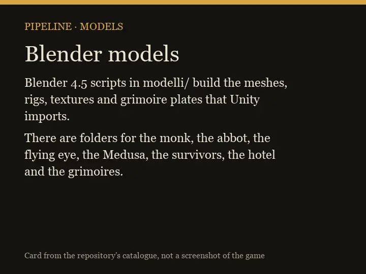

# Blender models

The three-dimensional figures that are made outside Unity come from the scripts in `modelli/`. The scripts run in Blender 4.5 LTS and write the models and textures that Unity imports. Each folder holds the scripts of one group of figures:

- `modelli/armi/`: the weapons, one script per family (pistols, rifles, shotguns, submachine guns, heavy and special weapons), with their textures and their sheets;
- `modelli/hotel/`: the furniture (`genera_arredi.py` to `genera_arredi5.py`), the arms and the hands (`genera_braccia.py`, `genera_mani.py`), the church and the textures;
- `modelli/monaco/`, `modelli/medusa/`, `modelli/occhio/`, `modelli/abate/`: the monk and its attack, the medusa, the flying eye and the abbot;
- `modelli/personaggi/`: the four survivors: body, face, hair, garments and skeleton;
- `modelli/temi/`: the accessories and the costume textures of the themes;
- `modelli/grimori/` and `modelli/chiesa/`: the grimoire tables (`prepara_tavole.py`) and the church (`genera_chiesa.py`).

## Checks

The commands that run these scripts, and the tests that read their output, are listed in [testing.md](../../docs/engineering/testing.md#21-asset-pipeline-produces-the-inputs-of-the-tests). Derived files stay out of git, as rule 4 of `AGENTS.md` says; only the scripts and their inputs are tracked.

## Related

- [Studio engine](studio-engine.md): the engine that can run the asset builds as jobs.
- [Pieta P-9](../weapons/pieta-p9.md): the starting pistol; the weapons of the game are generated by the scripts of `modelli/armi/`.
- [Monk](../enemies/monk.md): the enemy whose body the other enemies are built on.
