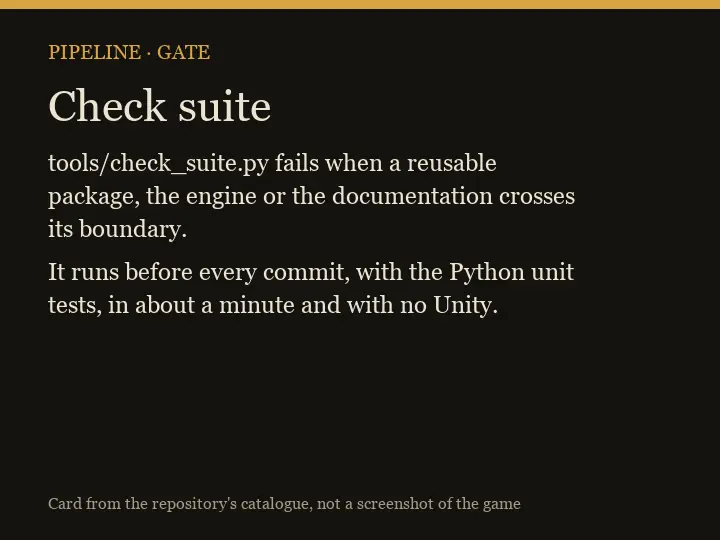

# Check suite

`python tools/check_suite.py` is the guard of the reusable suite. It fails when a boundary is crossed, so that the suite stays reusable only while something objects to its misuse. It exits `0` for PASS and `1` for each finding.

## What it checks

- **Packages.** Every package under `unity/PryingEyes/Packages` has a `package.json` named like its folder and a README. It compiles with `noEngineReferences` and no assembly references, so no `UnityEngine`. Its code names neither the game nor the engine. An engine-free lab under `tools/` compiles the same source file, and the independent project `unity/LayoutDemo` consumes it.
- **Engine.** The Python engine modules name no game, no content type and no tool of this project.
- **Game.** The game's own C# sources, read through the code census: no production file names a test type, every test file is wrapped in `PE_DISTRIBUTION_BUILD` so that a release can leave it out, and a game file that an engine-free lab compiles names neither `UnityEngine` nor `UnityEditor`. What is wrong today is listed, each item with its reason, in `tools/fixtures/game-boundaries.json`. The list can only shrink: a violation that is not in it fails the guard, and so does an entry whose violation is gone. See [the game's rules about tests](../../docs/engineering/suite-architecture.md#the-games-rules-about-tests).
- **Documentation.** Every relative link and anchor resolves, every page under `docs/` is listed in `docs/README.md`, every page starts with a title and is valid UTF-8, and no page names a path of one machine.
- **Wiki.** The wiki in `wiki/` passes its own checks, run by the [wiki generator](wiki-generator.md): every page has its front matter and an image that its body shows, every link and anchor resolves, every page is reached from the home page, and the files the generator makes (the catalogue, the concept map, `wiki/graph.json` and the static site) are up to date. A tree with no `wiki/` folder has nothing to check.

## Where it runs

Before every commit, through [ship](ship.md), together with the Python unit tests. On GitHub, on every push to `preview` and every pull request against it, through the [CI gate](ci-gate.md). Its own tests, in `tools/test_check_suite.py`, run the guard against a fixture repository that has every kind of violation, so a check that stops working fails a test.

## Related

- [Suite architecture](../../docs/engineering/suite-architecture.md): the boundaries this guard enforces.
- [Ship](ship.md): the script that runs the guard before it commits.
- [Wiki generator](wiki-generator.md): the wiki has its own checks, run from the same guard.
