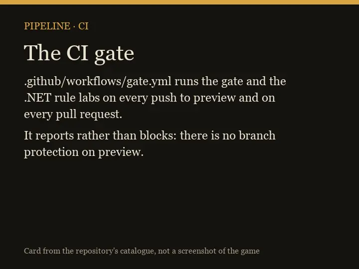

# CI gate

The gate is the workflow `.github/workflows/gate.yml`. It runs on every push to `preview`, on every pull request against it and on demand. It repeats on GitHub the checks that [ship](ship.md) runs on the maintainer's PC, and it adds the .NET labs, which need the project lock and so are not part of ship.

## What it runs

- The [check suite](check-suite.md), with the wiki's checks, and the Python unit tests.
- The four rule labs: `studio.py test weapon-state`, `survival`, `economy` and `saves`. See [labs](labs.md).
- The lab reports are kept as the artifact `lab-reports`.

## How it is built

- It runs on a Windows runner, because the engine's process trees use Windows Job Objects.
- Its checkout is sparse: only the paths the gate reads, about 20 MiB of files instead of the roughly 1.1 GiB the repository tracks. The list is the `sparse-checkout` block of the workflow.
- Every source a wiki page cites must be in that list, or the gate fails with `WIKI_SOURCE_MISSING`. This page cites the workflow file, so the list includes it.
- Its permissions are read-only.
- There is no branch protection, so the gate reports a failure rather than blocking a merge. Rule 8 of `AGENTS.md` makes the fix of a red run on `preview` the first task of any work.

## Related

- [Building, shipping and CI](../../docs/engineering/building-and-shipping.md#the-gate): the gate's place in the build guide.
- [Testing and verification](../../docs/engineering/testing.md): every check, with its command.
- [Ship](ship.md): the same checks, run before each commit.
