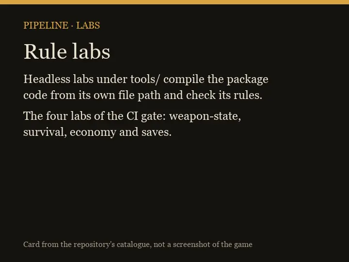

# Labs

A lab is a small .NET program that compiles the source of a package, or of the game's engine-free files, from its own path and runs its rules, with no Unity and no editor. A lab is a folder `tools/<name>lab`: `planlab` for the layout and the floor generator, `weaponslab` for the weapons, `survivallab` for the survival budget, `economylab` for the economy, `saveslab` for the saves, `tracklab` for the track mode and `desertlab` for the desert.

## How to run them

`python tools/studio.py suites` lists what the studio can run, with what each suite needs, what it can disturb and the seconds it usually takes. A lab needs nothing, and the gate runs every suite that needs nothing:

- `python tools/studio.py test <suite>` runs one, by the name the list gives it, for example `weapon-state`, `survival`, `economy`, `saves`, `track`, `desert` or `plan`.
- `python tools/studio.py test saves` is the save library and the character and run files, 115 checks.

They take the project lock, so [ship](ship.md) does not run them. The [CI gate](ci-gate.md) does, on GitHub. Their jobs leave a `report.json` under `unity_logs/studio/`, as described in [the studio engine](studio-engine.md).

A new lab is one entry in the profile, `tools/studio_pryingeyes.py`, and its folder. The workflow and `.gitignore` need no line for it.

## Why they are separate from the game

A package must be checked in the same file it ships in. A lab compiles that file, so the test proves the package on its own, without the game. The rules are in [suite architecture](../../docs/engineering/suite-architecture.md).

## Related

- [Studio engine](studio-engine.md): the engine that runs the labs as jobs.
- [Production saves](../packages/saves.md): the package the saves lab checks.
- [Testing and verification](../../docs/engineering/testing.md): the whole list of checks.
