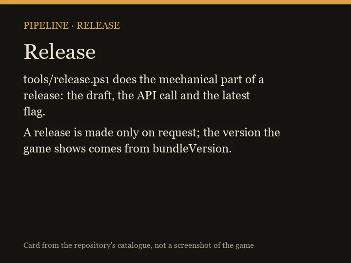

# Release

`tools/release.ps1 -Version x.y.z` prepares a release of Prying Eyes. It makes a build for distribution, searches the files to ship for the paths of the machine that built them, and packs a zip with its checksum. Then it runs the packaged executable once as a smoke test. It does not publish anything: the draft and the publication on GitHub are done by hand.

## The steps

- **check.** `bundleVersion` in `ProjectSettings` equals the version; the branch's `HEAD` equals `origin`, so the release comes from a pushed commit; nothing is left uncommitted.
- **build.** A distribution build (`-distribution`), which compiles out the test code and scrubs the paths.
- **scan.** A search of the shipped files for the paths of this machine.
- **zip.** `PryingEyes-v<version>-Windows-x64.zip` with its checksum, under the tag `v<version>`.
- **smoke.** The packaged executable starts and runs.

Each step can run alone with `-Step`. The version is the one the in-game menu shows (see the [version in the menu](../../docs/engineering/building-and-shipping.md#releases)).

## Rules

A release is made only when the maintainer asks for one. The version is raised in its own commit, pushed with [ship](ship.md) in full mode, and the [CI gate](ci-gate.md) must be green before this script runs.

## Related

- [Ship](ship.md): the script that builds and pushes the commits before a release.
- [Building, shipping and CI](../../docs/engineering/building-and-shipping.md): the releases section of the build guide.
- [CI gate](ci-gate.md): the green run that a release waits for.
