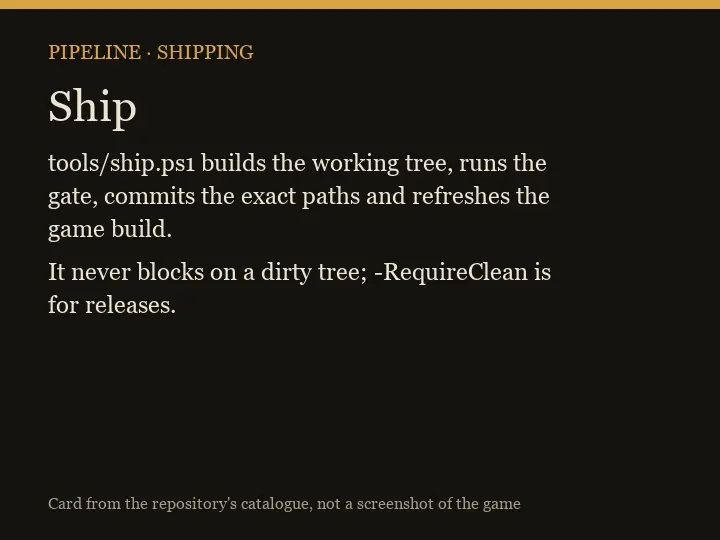

# Ship

`tools/ship.ps1` takes a change from the working tree to `preview`: it checks the branch, runs the gate, commits the paths it is given, builds, runs a smoke test, pushes and refreshes the game the maintainer plays. The sequence and its traps are already solved in the script, so an agent runs two commands and reads the result.

## The steps

1. **Checks.** The branch, that Unity is not open on the project, that no copy of the game runs from the build folder.
2. **Gate.** [Check suite](check-suite.md) and the Python unit tests. A failure stops the run before anything is committed.
3. **Commit.** The exact paths given with `-Paths`, with the message from `-MessageFile`.
4. **Build.** A full build when a non-code file changed, otherwise a scripts-only build (`-Mode auto`, `full` or `scripts`). The build is of the working tree, so the run lists the uncommitted sources it contains.
5. **Smoke test.** The navigation check with seed 1000 on two floors, without graphics.
6. **Push.** Never forced. Stops on any refused push.
7. **Refresh.** `Builds\PryingEyes.exe` is updated when the game is closed; if it is open, the copy finishes by itself when it closes.

The result is printed as `SHIP: OK`, `SHIP: FALLITO` or `SHIP: INTERROTTO`, with the record in `unity_logs/ship_last.log`. Options: `-Detach` and `-Wait` for an agent, `-DryRun` to test without changing anything, `-NoBuild`, `-NoPush` and `-NoExe`.

## Releases

`-RequireClean` refuses a dirty tree before the build, which is what a release needs. Releases are made with [release](release.md), only on request.

## Related

- [Building, shipping and CI](../../docs/engineering/building-and-shipping.md): the full reference of the build and the shipping.
- [CI gate](ci-gate.md): the same gate, run again on GitHub.
- [Release](release.md): the script that prepares a release from a pushed commit.
