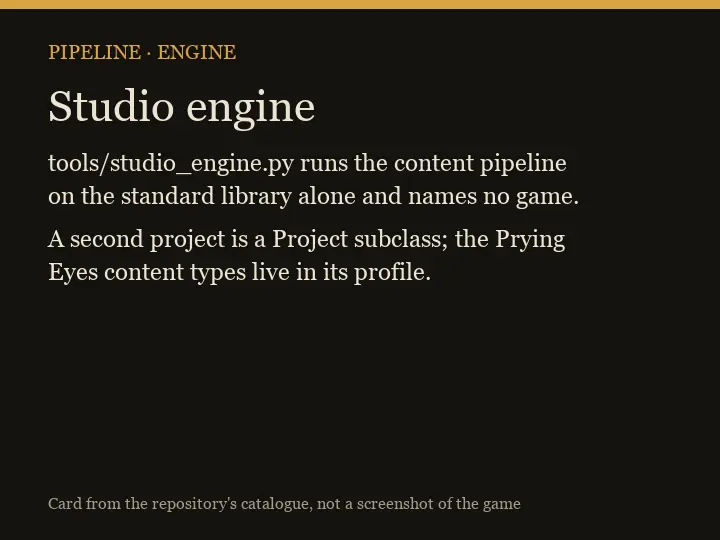

# Studio engine

The studio engine runs the production of the game's content: it bakes and checks the Blender models, builds the Unity players of the city prototype and runs the gunplay checks. It is written to serve any project. The engine uses only the Python standard library and names no game, no content type and no tool (rule 2 of `AGENTS.md`). What it knows about this game lives in one profile, `tools/studio_pryingeyes.py`.

## What it does

- A **job** writes one `report.json`: the operation, the hash of every source file it ran against, each step's command, log, exit code and timing, the findings as code, observed and expected, and the command that reproduces it.
- A **lock** per project, so two runs never open the same Unity project. A busy project is refused (`PROJECT_BUSY`), or the request waits in the queue.
- A **source guard**: if a hashed source changes while a job waits or runs, the job fails (`SOURCE_CHANGED_DURING_JOB`).
- **Owned process trees**: a step that times out or is cancelled stops the programs it started and their children.
- A **persistent queue** in SQLite, whose requests carry the sources they were submitted against.

The command line is `python tools/studio.py`, with `doctor`, `catalog`, `asset`, `test`, `report`, `gallery`, `queue` and `job`. The design is in [production-studio.md](../../docs/engineering/production-studio.md) and the boundary rules in [suite-architecture.md](../../docs/engineering/suite-architecture.md).

## Where it meets the rest

- The [check suite](check-suite.md) keeps the engine free of game names.
- The [labs](labs.md) are the tests the engine runs for the packages.
- The [Blender models](blender-models.md) are the first inputs of its asset builds.

## Related

- [Check suite](check-suite.md): the guard that runs before every commit.
- [Labs](labs.md): the engine-free tests of the packages.
- [Production saves](../packages/saves.md): one of the packages the engine tests.
