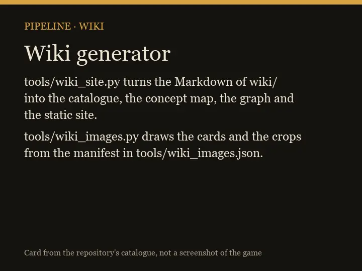

# Wiki generator

`tools/wiki_site.py` builds this wiki. It reads the pages under `wiki/`, checks them and writes the files the wiki generates: the [catalogue](../catalog.md), the concept map, `wiki/graph.json` and the static site under `wiki/site/`. The site opens from its `index.html` with no server and no network.

## Commands

- `python tools/wiki_site.py` regenerates the generated files and the site. It writes nothing while a finding is open.
- `python tools/wiki_site.py --check` checks everything and exits `1` on any finding, including a generated file that is out of date.
- `python tools/wiki_images.py` renders the cards and thumbnails of the pages from `tools/wiki_images.json`, with Pillow. Its `--only` option renders a part.

`tools/wiki_site.py` uses only the standard library, so the [check suite](check-suite.md) and the CI gate run its check without Pillow; only the cards need Pillow.

## What it checks

Every page has the front matter: a title equal to its first heading, a kind that fixes its folder, a mode, a summary and an image that the body shows. The pages of the game have a section about the standard and the desert. Every link and anchor resolves; every page is reached from the home page; every page links to at least two others; every image is shown by a page. The concepts of `wiki/concepts.json` point at existing pages, and the paths written in code spans exist.

The tests in `tools/test_wiki_site.py` build a small wiki in a temporary folder for each check, so they do not read these pages.

## Related

- [Check suite](check-suite.md): the guard that runs the wiki check with the documentation check.
- [Catalogue](../catalog.md): the table of contents the generator writes.
- [Standard vs desert](../standard-vs-desert.md): the page that the standard-and-desert sections feed.
