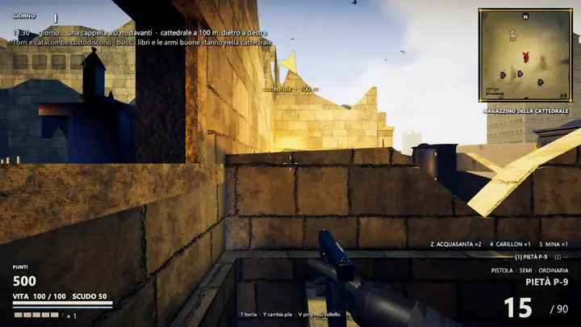

# The chapel (desert place)

The chapel is a small church of the desert, built from the rooms of the floors. It is marked with a cross on the minimap, as the churches
are, and it stands among the places of the holy land.

## What it is like

- **Its state.** A chapel is whole, ruined, split or collapsing. A ruined chapel may have walls with no roof, and the jagged tops of its
  broken walls are finished like the rest of the outside.
- **Its yard.** Two to four props stand outside it, as for a house.
- **Its guards.** Like every place it has guards, by the same rule as the houses.
- **The welcome chapel.** The cell 100 m from the cathedral is always a ruined chapel: the [welcome chapel](../landmarks/welcome-chapel.md),
  the first landmark a player usually walks to.

## Standard and desert

The standard game has chapels inside the floors and the cathedral: the Cappella della Pietra and the Cappella delle Mani are cathedral works.
The desert's chapels stand outside, on the sand, and are found by walking.

## Related

- [The holy land](../regions/holy-land.md): the region where chapels stand.
- [The church](church.md): the larger place of the same region.
- [The welcome chapel](../landmarks/welcome-chapel.md): the chapel 100 m from the cathedral.
- [The desert](../modes/desert.md): the open world as a whole.
