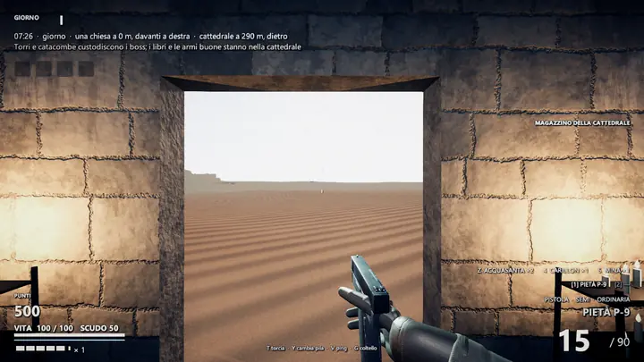

# The church (desert place)

The church is a nave built from the rooms of the floors, seen from the sand. It is marked with a cross on the minimap and stands among the
places of the holy land.

## What it is like

- **The nave.** Inside a church the echo is the church's own: about 3.6 s, against 0.45 s on the open sand.
- **Its yard.** The yard of a church gets steles, cairns and a broken column, as well as the crates, bushes and bones of every place.
- **Its state.** A church is whole, ruined, split or collapsing, like the other places, and its outside is finished with pilasters, buttresses,
  windows with frames and shutters, and a cornice.
- **Its guards.** Like every place it has guards, by the same rule as the houses.

## Standard and desert

The standard game's naves are the cathedral's nave, a ruin that you rebuild with the works, and the naves of the floors. The desert's churches
are outside, on the sand, and are found by walking or by the motorbike.

## Related

- [The holy land](../regions/holy-land.md): the region where the churches stand.
- [The chapel](chapel.md): the smaller church of the same region.
- [The obelisk](../landmarks/obelisk.md): a tall landmark of the holy land.
- [The desert](../modes/desert.md): the open world as a whole.
