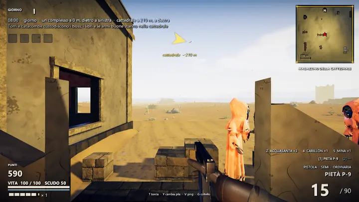

# The complex (desert place)

The complex is one of the eight kinds of place of the desert. It is a large group of rooms, seen here in ruin, with about twenty-four rooms
in the picture.

## What it is like

- **Its state.** A complex is whole, ruined, split in pieces or collapsing, like the other places. The picture shows a ruined one, with the
  rooms open to the sky.
- **Its yard.** The sand round it is given props by the same rule as every other place.
- **What the desert page says.** It names complexes among the places of the desert and says that they are made of the rooms of the floors.
  The desert document does not describe a complex in more detail, nor the regions where it stands most often.

## Standard and desert

The standard game has no complexes; its rooms are the rooms of the branches. In the desert a complex is a building on the sand, reached on
foot or by the motorbike.

## Related

- [The house](house.md) and [the hotel](hotel.md): the other kinds of place.
- [The desert](../modes/desert.md): the open world as a whole.
- [The regions](../regions/dunes.md): the kinds of land on which places stand.
