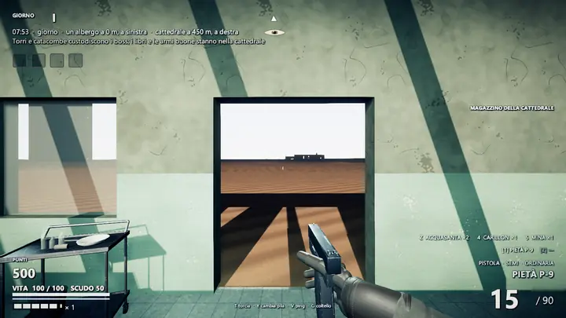

# The hotel (desert place)

The hotel is a large place of the dead town: the hotel rooms of the floors, built on the sand, whole or falling apart. Its outside is the
building that the desert finishes for every place.

## What it is like

- **Its state.** A hotel is whole, ruined, split in pieces or collapsing. A whole hotel has a pitched or flat roof with battlements and window
  frames with shutters; a ruined one has rubble at its foot and the jagged tops of its broken walls.
- **Its yard.** A hotel gets three to seven props in the sand round its walls: crates, barrels, a wagon, bushes, bones.
- **Its guards.** Like every place, it has guards by the same rule as the houses.
- **Its far skin.** Seen from afar the hotel is about 1,100 vertices of roofs and lit windows at night.

## Standard and desert

The standard game's hotel rooms are the theme of the first branch, the Ossario, a hotel and a church buried under the cathedral (see
[the Ossario](../branches/ossario.md)). The desert's hotel is a building on the sand, reached on foot or by the motorbike.

## Related

- [The dead town](../regions/dead-town.md): the region where most hotels fall apart.
- [The theatre](theatre.md) and [the sanatorium](sanatorium.md): the other large places of the dead town.
- [The tower](../stacks/tower.md): the stack built from the same kind of floors.
- [The desert](../modes/desert.md): the open world as a whole.
