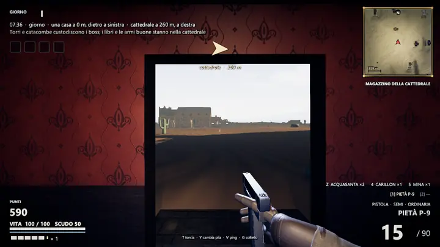

# The house (desert place)

The house is the smallest kind of place of the desert: a few rooms of the floors, built as a building on the sand. It is the place that
stands most often in the hamlets, where many small houses make up the villages of the region.

## What it is like

- **Its state.** A house is whole, ruined, split in pieces or collapsing, and the state is drawn per place. A whole house has a roof of
  tiles, slate, lead or tar, by theme, and a plinth, window frames with shutters and blind windows where there is no room.
- **Its yard.** Each house gets two to four props in the sand just outside its walls: crates and barrels, bushes, a dead tree, tufts or
  bones. None stand within 4.2 m of a door that opens outside.
- **Its doorway.** A doorway that a lowered wall cuts below the height of a person is left open, so a ruined house can be walked into.
- **Its guards.** Every place has guards. A house gets one to nine, by its number of rooms and by how far it is from the cathedral.
- **Its far skin.** From 760 m the house is a simple silhouette with lit windows at night; the full rooms are built within 280 m.

## Standard and desert

The standard game has no houses on the outside: the rooms that make a house here are rooms of the floors, seen only from inside the
Tower. In the desert the house is a place of its own, with the outside finished and the sand round it.

## Related

- [The hamlets](../regions/hamlets.md): the region where the houses stand most.
- [The inn](inn.md): the other small place of the hamlets.
- [The well](../landmarks/well.md): a landmark that stands among the hamlets' places.
- [The desert](../modes/desert.md): the open world as a whole.
