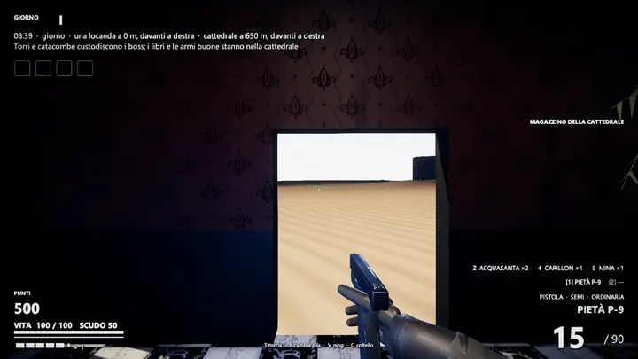

# The inn (desert place)

The inn is a small hostelry of the hamlets. The desert page names it with the houses and the wells as the things the hamlets are made of.
This picture shows one that is in ruin.

## What it is like

- **Its state.** An inn is whole, ruined, split or collapsing. The picture shows a ruined one.
- **Its yard.** Each inn gets three to seven props in the sand round it, as the larger places do: crates and barrels, a wagon now and then,
  bushes, a dead tree, tufts and bones.
- **Its guards.** Like every place, it has guards by the same rule as the houses.
- **Its rooms.** The rooms inside are rooms of the floors, so an inn can be walked into through a door or a broken wall.

## Standard and desert

The standard game has no inns on the outside; its rooms are the rooms of the floors. The desert's inn is a place on the sand, found by
walking or by the motorbike.

## Related

- [The hamlets](../regions/hamlets.md): the region where the inns stand.
- [The house](house.md): the other small place of the hamlets.
- [The well](../landmarks/well.md): a landmark of the hamlets.
- [The desert](../modes/desert.md): the open world as a whole.
