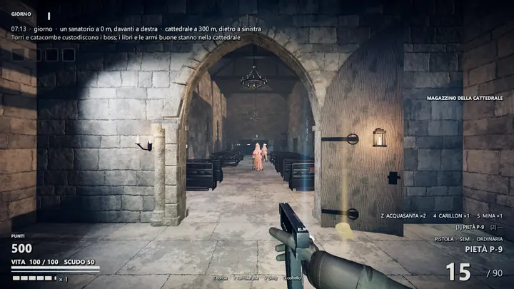

# The sanatorium (desert place)

The sanatorium is a place of the dead town: the wards of the standard sanatorium, built on the sand, whole or falling apart.

## What it is like

- **Its state.** A sanatorium is whole, ruined, split or collapsing, like the other large places. The picture shows one that is whole.
- **Its yard.** The yard holds the same kinds of props as the other large places.
- **Its enemies.** The desert page says that sanatoria have their own enemies, as the theatres do. The standard sanatorium's enemies are the
  Infermiere and the [Primario](../enemies/primario.md). The desert page does not say which of them walk the sand.

## Standard and desert

The standard game's sanatorium is the Sanatorio branch under the cathedral, with its own boss, the Primario (see
[the sanatorium branch](../branches/sanatorio.md)). The desert's sanatorium is a building on the sand, reached on foot or by the motorbike.

## Related

- [The dead town](../regions/dead-town.md): the region where sanatoria fall apart.
- [The Infermiere](../enemies/infermiere.md): the nurse of the standard sanatorium.
- [The theatre](theatre.md): the other place of the dead town with enemies of its own.
- [The desert](../modes/desert.md): the open world as a whole.
