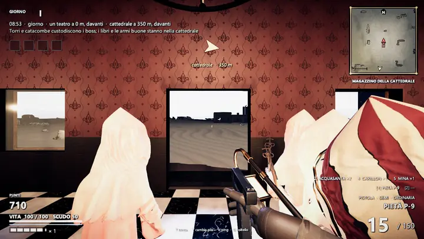

# The theatre (desert place)

The theatre is a place of the dead town: the theatre of the standard floors, built on the sand with a hall and a stage, whole or falling apart.

## What it is like

- **Its state.** A theatre is whole, ruined, split or collapsing, like the other large places. The picture shows one that is whole.
- **Its yard.** Its props are placed round the walls by the same rule as every other place.
- **Its guards.** Like every place, it has guards by the same rule as the houses.
- **Its enemies.** The desert page says that theatres and sanatoria have enemies of their own, and does not name them. The standard
  theatre's enemies are the Maschera and the [Direttore](../enemies/direttore.md).
- **Its sound.** Inside a place the hum of a room and the room's echo come back, as in the standard floors.

## Standard and desert

The standard game's theatre is the Teatro sepolto branch, a set of rooms under the cathedral with its own boss (see
[the buried theatre](../branches/teatro-sepolto.md)). The desert's theatre is a building on the sand, reached on foot or by the motorbike.

## Related

- [The dead town](../regions/dead-town.md): the region where theatres fall apart.
- [The Maschera](../enemies/maschera.md): the theatre's usher of the standard game.
- [The sanatorium](sanatorium.md): the other place of the dead town that the desert gives enemies of its own.
- [The desert](../modes/desert.md): the open world as a whole.
