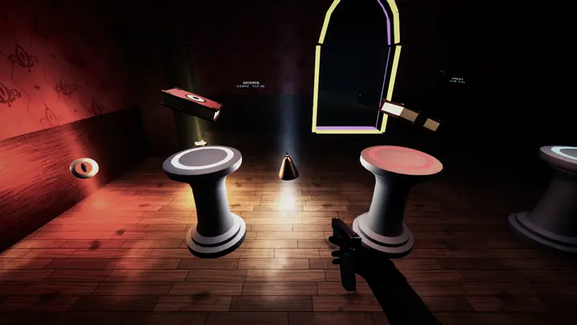

# Campana

Campana (bell) is one of the four power-ups. It is a last resort: it kills everyone near you, and its sound calls everyone else.

## What it does

- **Kills.** Everyone in the current round and everything within 22 m dies, each with `DamageSource.Nuke`. The desert has no rounds, so there only the 22 m count.
- **Points.** 400 for the player who takes it (each seat, in split screen). The bell's own kills pay nothing: the code gives `DamageSource.Nuke` no points (`Punti.cs`).
- **Alarm.** Once the kills are done, the toll is heard within 55 m, and the survivors come looking for you.
- **No chain.** The bell's kills make no power-up fall.
- **Co-op.** The enemies fall in the host's game, around the player who took the bell.
- **Candle cycle.** The tower note calls it a double-edged weapon in the candle cycle, the older cycle with candles to light.

## Standard and desert

Both modes. The same code runs in the desert, where the bell kills what is within 22 m. The desert note does not mention it.

## Related

- [Sguardo](sguardo.md): the gaze power-up, which the bell's blast does not change.
- [Reliquiario](reliquiario.md) and [Offerta](offerta.md): the other power-ups.
- [The Veglia](../enemies/veglia.md): the enemy that the procession brings.
