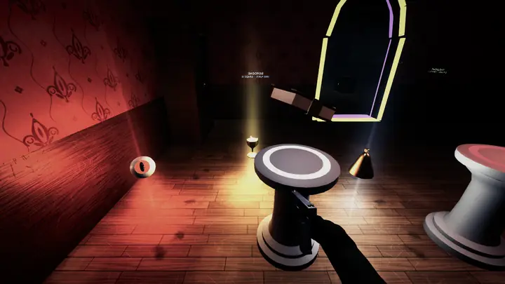

# Offerta

Offerta (offering) is one of the four power-ups. For 30 seconds the points are doubled.

## What it does

- **Duration.** 30 seconds (`Drops.Duration`). The banner reads "I punti valgono il doppio."
- **Points.** Every positive gain that goes through `GameManager.AddPoints` is doubled, the bell's 400 included. The desert's coins go through the same function, so a coin taken during the effect pays double.
- **Everyone.** In co-op the guest gets the effect too, and in split screen every player gets it, while the timer runs once. The co-op test checks both sides (`CoopTest.cs`).

## Standard and desert

Both modes. In the desert the effect doubles the value of the coins (see [Points](../pickups/points.md)).

## Related

- [Points](../pickups/points.md): the desert's gold coins, which the effect doubles.
- [Reliquiario](reliquiario.md), [Sguardo](sguardo.md) and [Campana](campana.md): the other power-ups.
- [Provvidenza](../blessings/provvidenza.md): a different effect, which changes how often power-ups fall on the catacomb floors.
