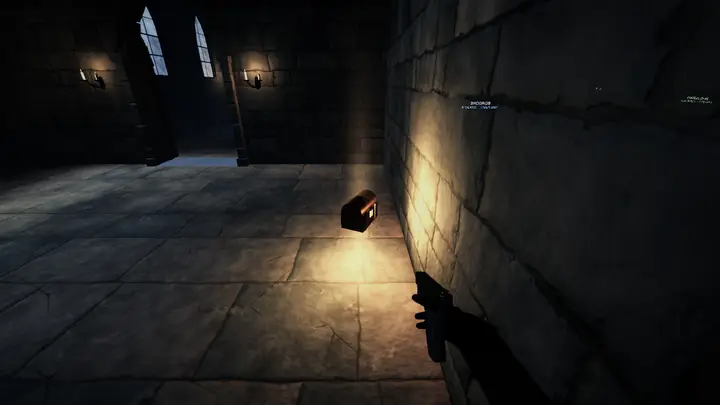

# Reliquiario

The Reliquiario (relic) is one of the four power-ups. The tower note models the four on those of Black Ops Zombies. This one fills your ammunition.

## What it does

- **Ammunition.** It cancels a reload in progress and fills the magazine and the reserve of both weapons to the maximum (`Weapon.MaxAmmo`). The banner reads "Munizioni al massimo."
- **Procession.** Every fifth round or wave comes the Processione dei Lumi (the Procession of Lights): only Veglie spawn, 60 % more than usual, and up to four more are alive at the same time. The code multiplies by 1.6 (`RoundDirector.MothCountMul`); a comment beside it says "una volta e mezzo", one and a half, but the constant is what runs. At the end a Reliquiario always drops where the last Veglia died. It does not count toward the four power-ups that a floor allows.

## How it falls

- A kill drops one of the four with a chance of 4.5 %. A knife kill doubles the chance, and a takedown quadruples it.
- At most four lie on a floor at a time. The four kinds come from a shuffled bag, so each one comes round before any repeats.
- A power-up lies on the ground for 30 seconds, then disappears.

## Standard and desert

Both modes. The desert's kills run through the same code, so a Reliquiario can fall there too. The procession belongs to the tower floors, where the rounds and waves are; the desert has no waves, so it has no procession.

## Related

- [Sguardo](sguardo.md), [Offerta](offerta.md) and [Campana](campana.md): the other three power-ups.
- [The Veglia](../enemies/veglia.md): the enemy that the procession brings.
- [Provvidenza](../blessings/provvidenza.md): the altar's blessing that doubles how often power-ups fall on the catacomb floors.
- [Ammunition crate](../pickups/ammunition-crate.md): the desert's ammunition find.
