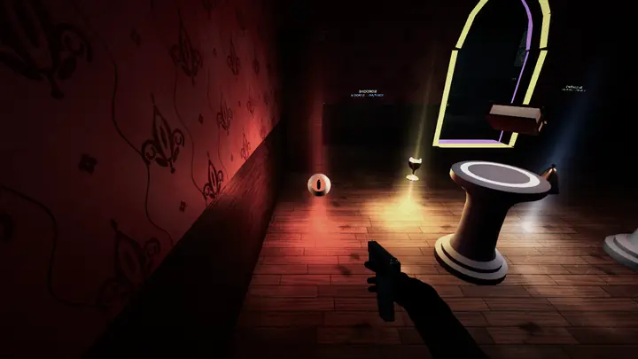

# Sguardo

Sguardo (gaze) is one of the four power-ups. For 30 seconds every shot kills.

## What it does

- **Duration.** 30 seconds (`Drops.Duration`). The banner reads "Ogni colpo uccide."
- **Kills.** Every hit kills: the damage is raised to the enemy's health plus one (`Enemy.cs`). The one exception is the bell's blast, [Campana](campana.md), whose damage source is `DamageSource.Nuke`.
- **Everyone.** In co-op and split screen the timer belongs to the world: it starts once, and every player has the effect.

## Standard and desert

Both modes. The desert's enemies take the same damage, so the gaze works there too. The desert's bike test switches the random drops off for this reason: a gaze that fell from the first monk would have let the rider kill the second one at a single hit.

## Related

- [Campana](campana.md): the bell, whose blast the gaze does not change.
- [Reliquiario](reliquiario.md) and [Offerta](offerta.md): the other power-ups.
- [The monk](../enemies/monk.md): an enemy of both modes.
